# Discover: How a Junior Employee Found Payroll, Medical Notes and a Secret Redundancy Plan

**Part 1 of 3.** [← Back to overview](README.md) · Next: [Protect →](02-protect.md)

The company is fictional: **Tayside Freight Ltd**, a Dundee haulage firm. Before Copilot is switched on, one question matters: what can **Alex Carter**, a junior Operations employee, find today?

---

## 1 · Build the company

I built the company from scratch with scripts written using Claude Code: **12 staff, 5 departments (Board, HR, Finance, Operations, All Staff), each with its own SharePoint site, and 42 realistic fake files**. Using scripts means the whole company can be rebuilt the same way at any time.

**The traps inside the data:**
- An **old payroll export** left in `Operations/Old Reports`
- A **copy of the board minutes** (including the "Project Thistle" redundancy plan) in the All Staff archive
- **Salaries and NI numbers in a hidden sheet** of the fleet schedule
- A **payslip export** prepared for an external accountant

All personal data is fake: NI numbers use the unissued `QQ` prefix, sort codes start `99-`, and the card number is a standard test number.

---

## 2 · Make the mess

Real oversharing builds up through small "quick fixes". I recreated four of them.

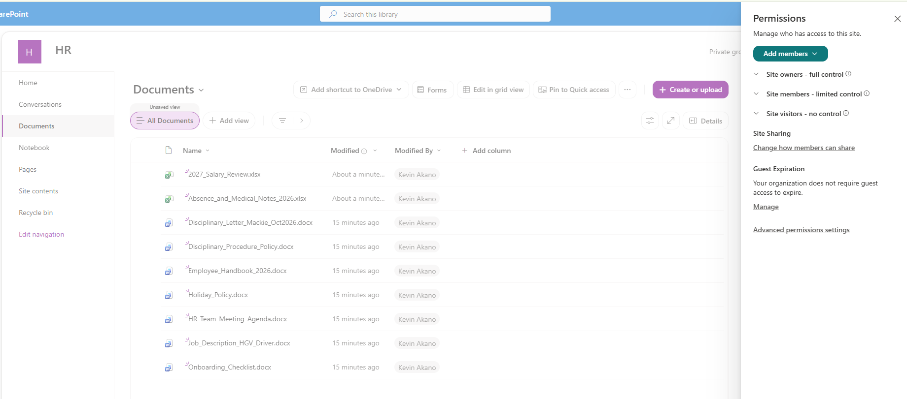

**Mess 1:** All Staff added as visitors to the HR site, so everyone could read HR files.

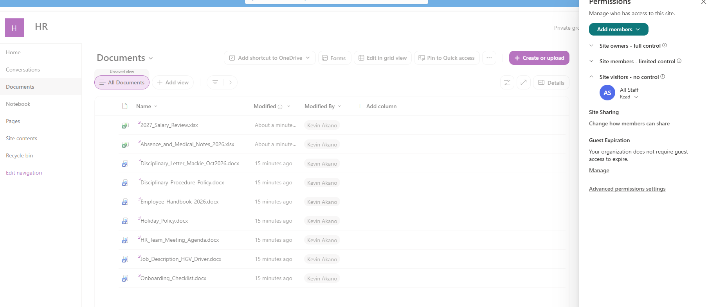

**Mess 2:** the payroll file shared directly with All Staff.

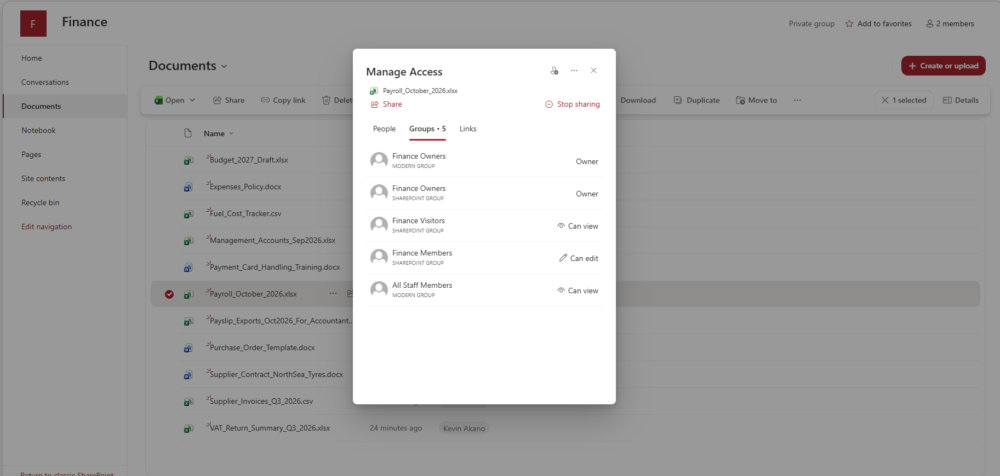

**Mess 3:** a Finance folder ("Month End Pack") with broken inheritance, open to All Staff.

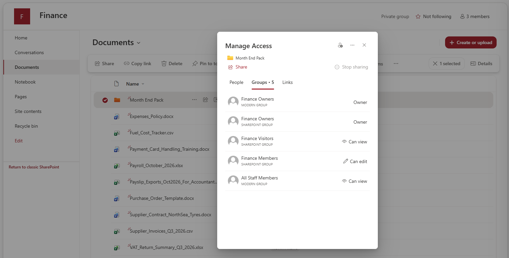

**Mess 4:** an external guest (playing the company's accountant) invited to the Finance site.

---

## 3 · Search as Alex

Signed in as Alex, I ran six searches, the same kinds of questions someone would ask Copilot.

| Search | What Alex found |
|---|---|
| salary | 2027 salary review, old payroll export, fleet schedule (hidden sheet) |
| payroll | Live October payroll with NI numbers and bank details |
| board minutes | Board minutes copy in the All Staff archive |
| redundancy | Planned job cuts, estimated cost £410,000 |
| Project Thistle | The confidential restructuring plan, by name |
| medical | Absence and medical notes |

**6 sensitive files** were exposed. Medical notes are **special category data** under UK GDPR.

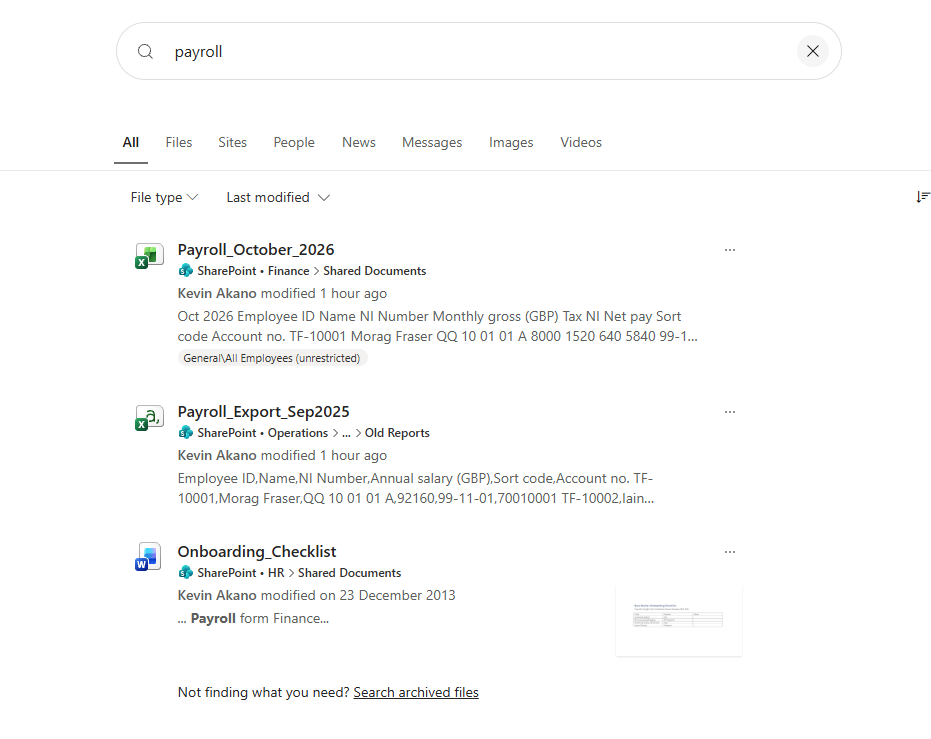
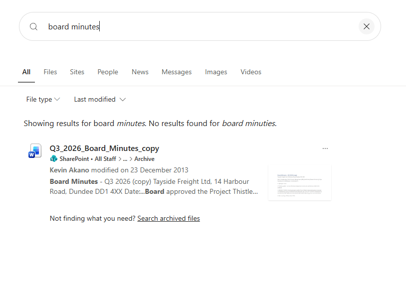
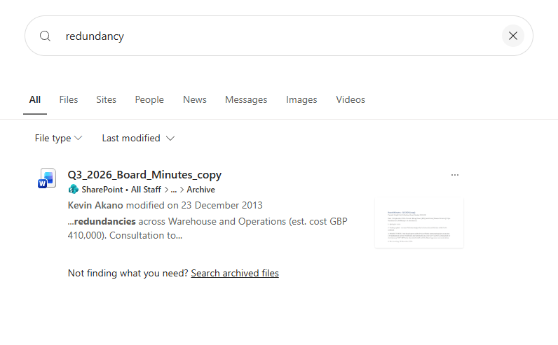
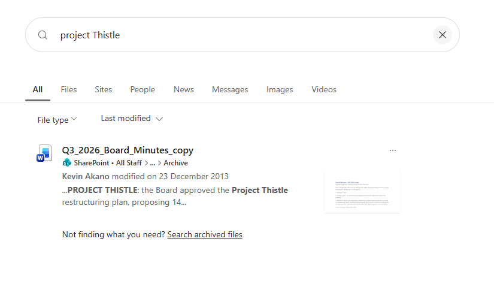
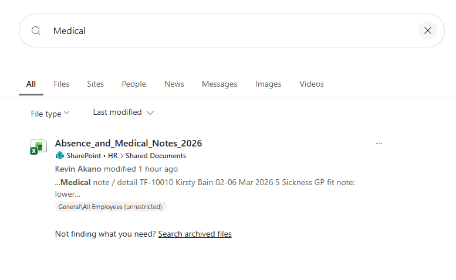

---

## 4 · Prove it with the audit log

Search shows what Alex *could* reach. The audit log shows what he *did*. Audit ingestion was **off** in the new tenant, so the first step was turning it on:

```powershell
Connect-ExchangeOnline -Device
Set-AdminAuditLogConfig -UnifiedAuditLogIngestionEnabled $true
Get-AdminAuditLogConfig | Select-Object UnifiedAuditLogIngestionEnabled   # True
```

The audit search then confirmed that on **29 Oct 2026 between 22:38 and 22:43 UTC**, Alex opened payroll, the salary review, the old export and the board minutes copy.

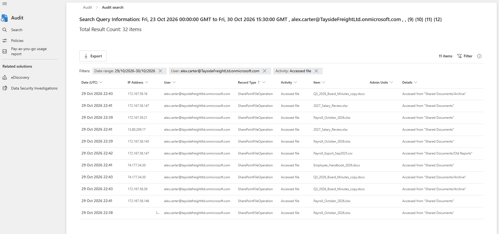

---

## 5 · What discovery found, including where the tools fell short

**Finding: the default label gave no protection.** The tenant came with Microsoft's default labels. The default policy stamped every new file *General / All Employees (unrestricted)*, payroll included. This is visible on Alex's search results.

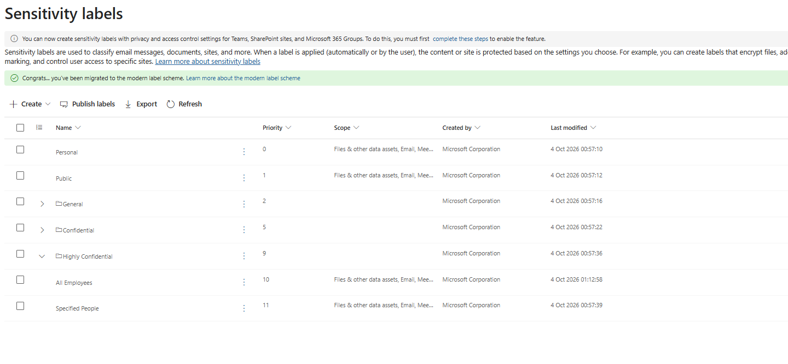

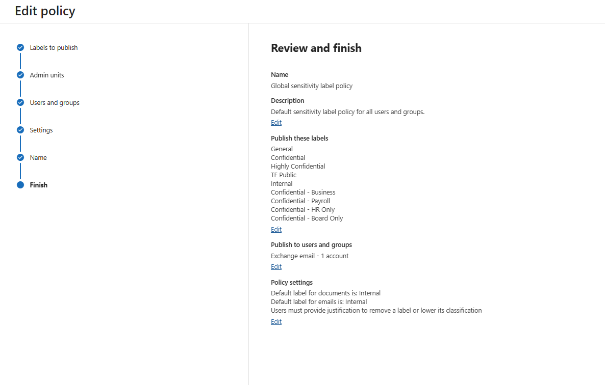

**Finding: "all sites" didn't mean all sites.** The DSPM for AI data risk assessment was set to cover all sites, but it returned only four. **Finance and Board, the two most sensitive sites, were never scanned.** 30 of 32 scanned items had no label.

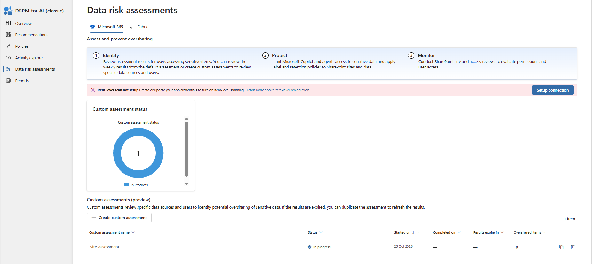

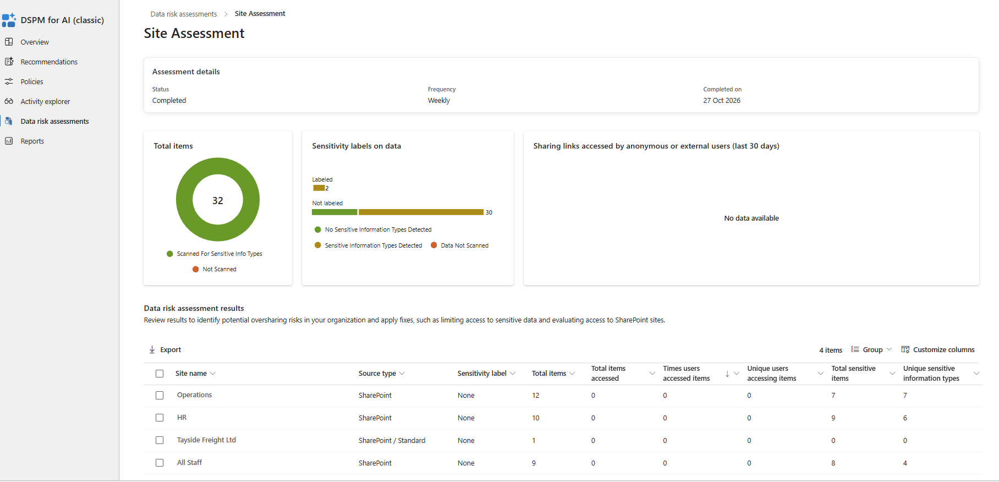

**Finding: Conditional Access also blocks guests.** CA03 (require a compliant device) blocked the external guest's sign-in (`530004`), because it applies to guests too.

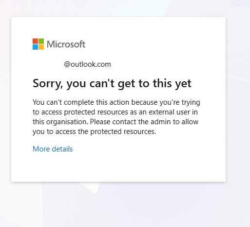

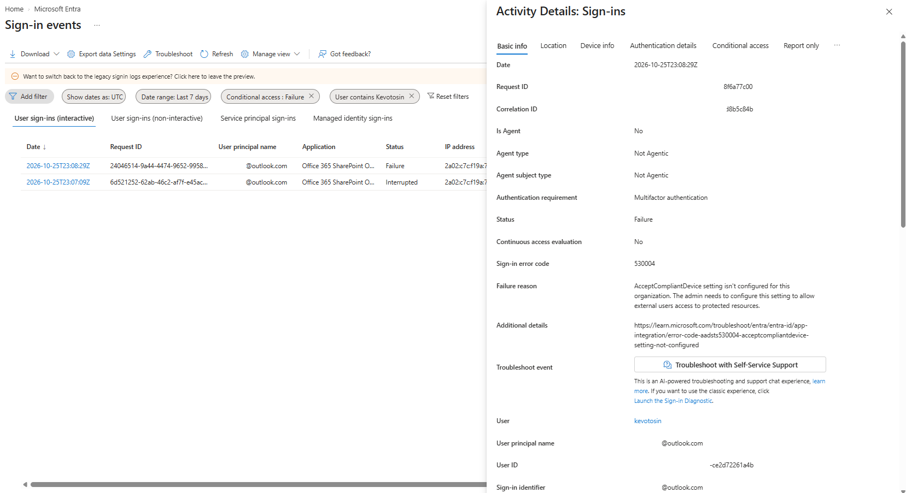

**Limitation:** Content explorer and Activity explorer stayed empty during the lab window, so evidence came from search tests and the audit log instead.

---

**Next:** [Protect: Labels, Custom Detectors, Auto-Labelling and DLP →](02-protect.md)

*Personal hands-on lab by Kevin Akano. Tenant, company name, and user personas are fictional.*
