# Protect: Labels, Custom Detectors, Auto-Labelling and DLP

**Part 2 of 3.** [← Discover](01-discover.md) · [Overview](README.md) · Next: [Remediate & Prove →](03-remediate-and-prove.md)

Permissions decide **who can reach** a file. Labels and DLP decide **what happens to the file wherever it goes**, including into Copilot.

---

## 1 · Sensitivity labels

Six labels, ordered so that a higher priority number means more sensitive. The top labels use **access control (encryption)**, so only the named groups can open the file, even if it's copied elsewhere.

| Priority | Label | Intended for |
|---|---|---|
| 12 | TF Public | Anyone |
| 13 | Internal | All staff (new default) |
| 14 | Confidential - Business | Business-sensitive, staff only |
| 15 | Confidential - Payroll | HR + Finance |
| 16 | Confidential - HR Only | HR |
| 17 | Confidential - Board Only | Board |

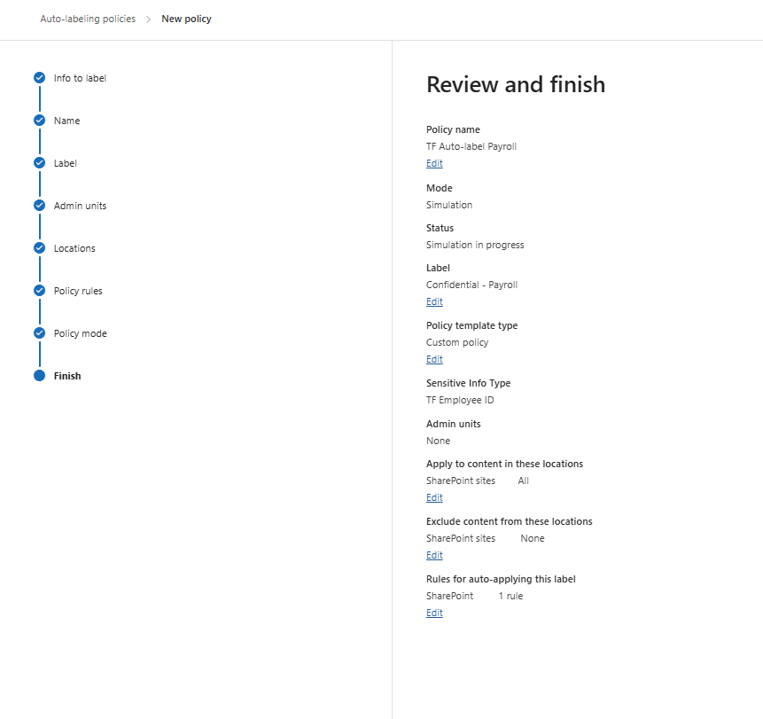

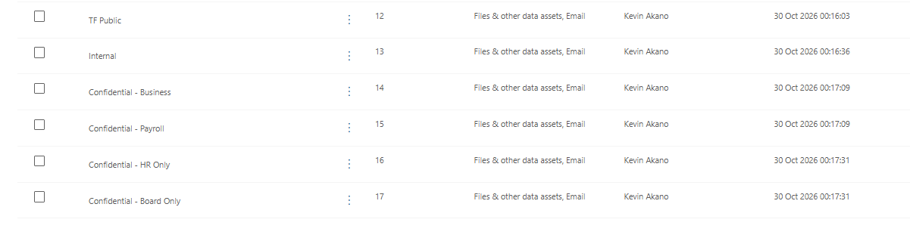

**Publishing policy:** published to all users, default label changed from *General / All Employees (unrestricted)* to **Internal**, and users **must give a reason** to lower or remove a label.

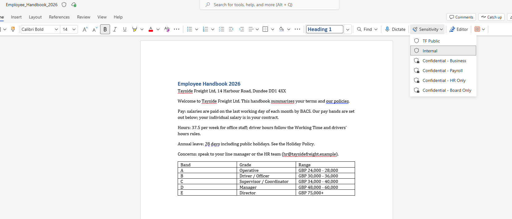

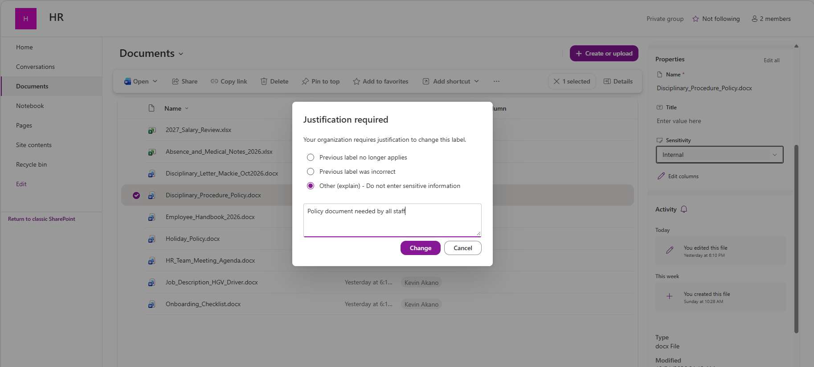

---

## 2 · Custom detectors (sensitive info types)

Microsoft's built-in detectors don't know a company's own ID formats. I wrote three regex detectors, each needing a supporting keyword to reach high confidence.

```text
TF Employee ID     \bTF-\d{5}\b                          keywords: Employee ID, Employee, Staff
TF Lab NI Number   \bQQ ?\d{2} ?\d{2} ?\d{2} ?[A-D]\b    keywords: NI Number, National Insurance, NINO
TF Lab Sort Code   \b99-\d{2}-\d{2}\b                    keywords: Sort code, Account no, Bank
```

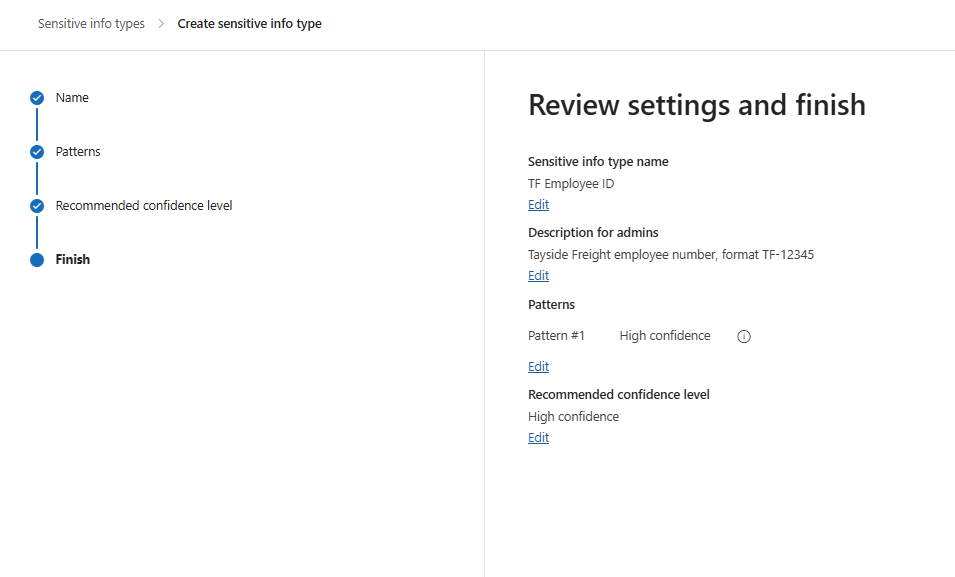

**The proximity fix.** The first test on the payroll file found only **3 of 12** employee IDs. The keyword "Employee ID" sits in the column header, too far from the rows below it. Changing keyword proximity to **"anywhere in the document"** took detection to **12 of 12**.

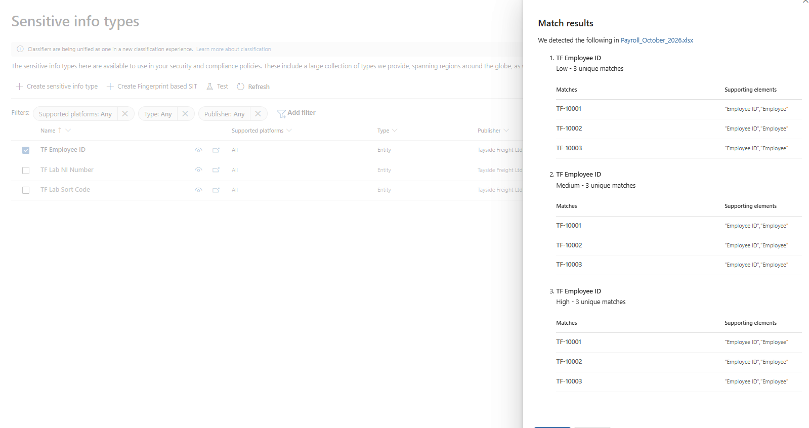

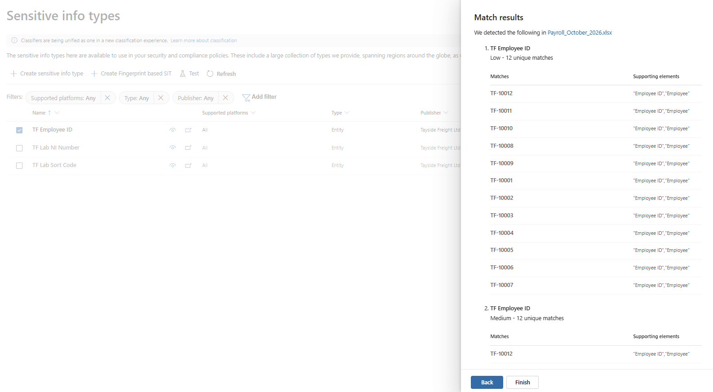

---

## 3 · Auto-labelling

One rule, so the label is applied only when there is real payroll-style data, not just an employee ID:

```text
TF Employee ID  AND  ( TF Lab NI Number  OR  TF Lab Sort Code )   →   Confidential - Payroll
Location: all SharePoint sites
```

**Simulation found 0 files at first.** The rule was fine; the search index was out of date. After re-indexing the Finance, HR and Operations sites, the simulation matched payroll **and the fleet schedule**, because of its hidden salary sheet. After the hidden sheet was removed, only payroll matched, and the policy was turned on.

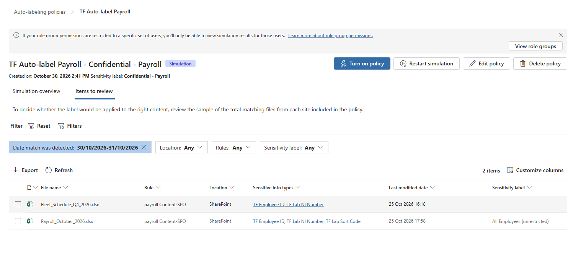

**Lessons:** CSV files can't carry labels, so CSV exports have to be handled by permissions and DLP. Auto-labelling never overrides a label someone applied by hand.

---

## 4 · Data loss prevention

**Policy 1: TF Payroll - no external sharing**
```text
Locations:  Exchange email, SharePoint, OneDrive
Condition:  TF Employee ID (high confidence) AND shared with people outside the organisation
Action:     Block people outside the organisation · policy tip · override with business justification
Severity:   High
```

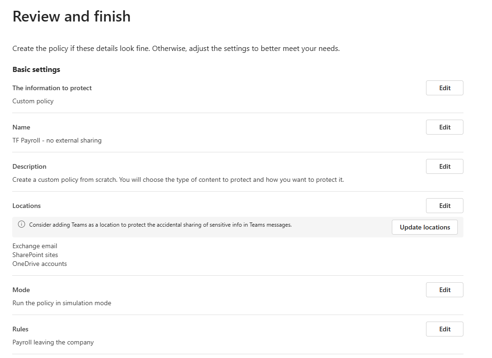

**Policy 2: TF Copilot - protect top labels**
```text
Location:   Microsoft 365 Copilot and Copilot Chat
Condition:  Label is Confidential - Payroll, HR Only or Board Only
Action:     Block Copilot from processing the content
```

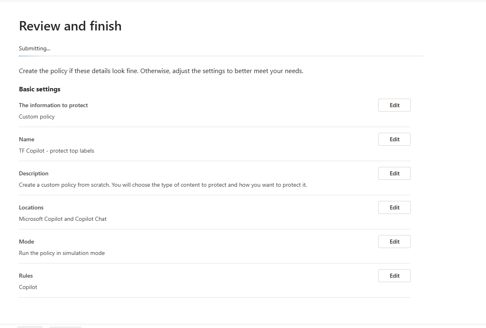

Both ran in simulation first, then were switched **On**.

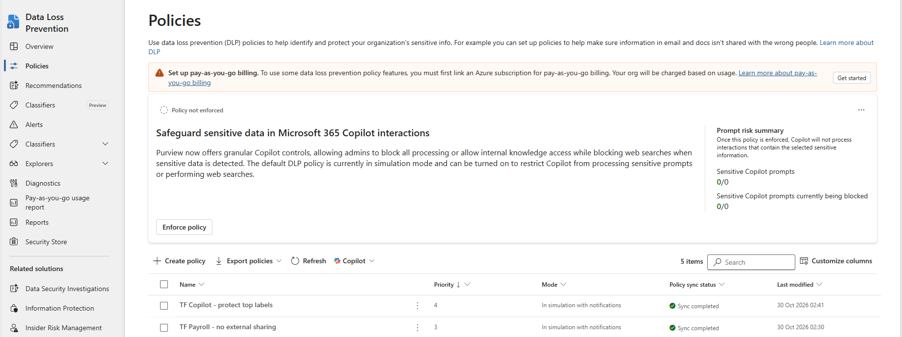

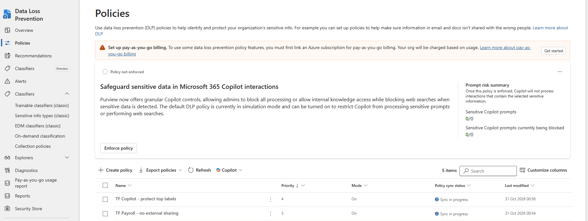

---

**Next:** [Remediate & Prove: From 6 Exposed Files to 0 →](03-remediate-and-prove.md)

*Personal hands-on lab by Kevin Akano. Tenant, company name, and user personas are fictional.*
