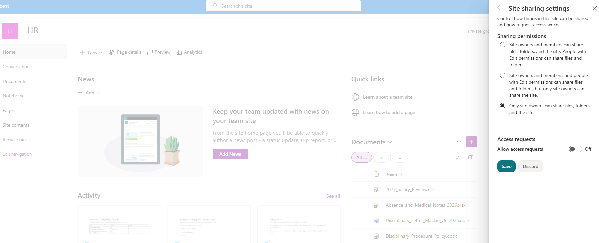
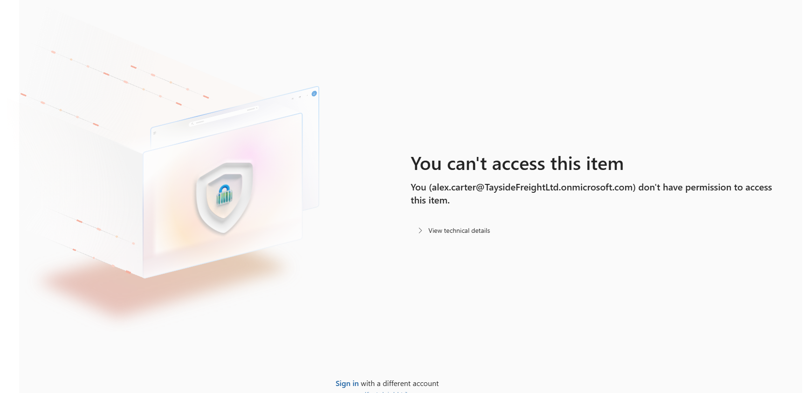
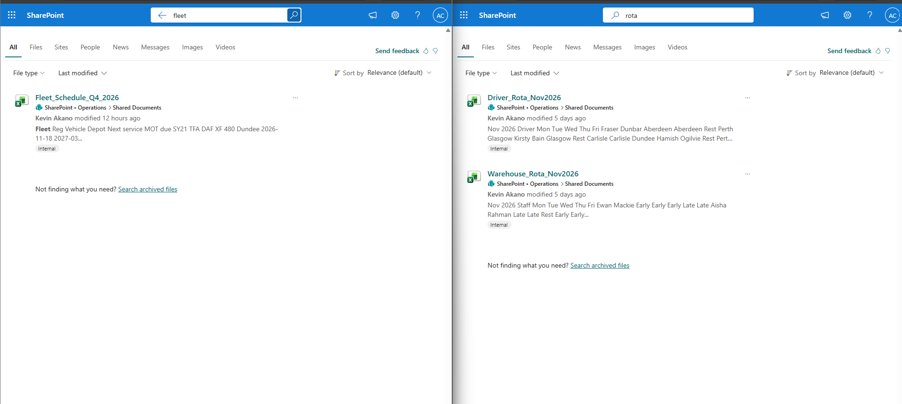
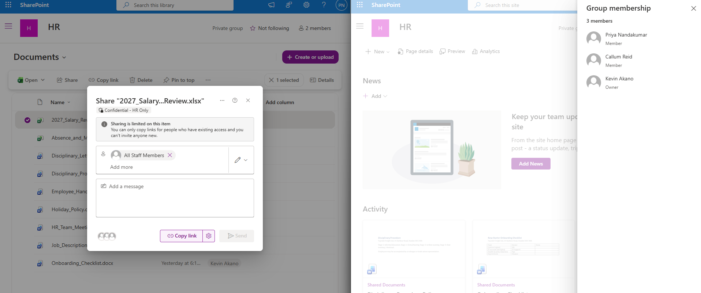
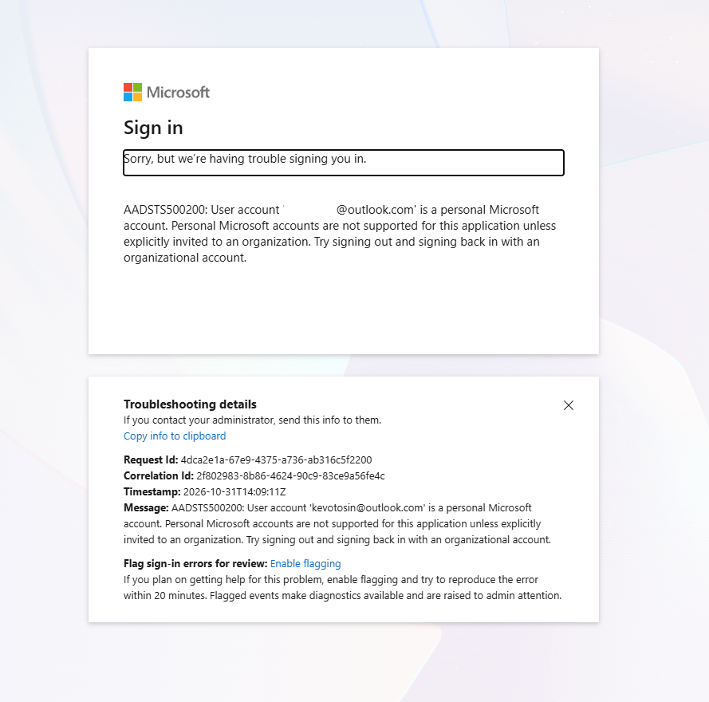

# Remediate & Prove: From 6 Exposed Files to 0, and Making It Impossible to Repeat

**Part 3 of 3.** [← Protect](02-protect.md) · [Overview](README.md)

Labels and DLP protect the data. They don't undo the bad permissions. This part fixes the root causes, stops them coming back, and proves it.

---

## 1 · The fixes, as tickets

| Ticket | Fix |
|---|---|
| 5.1 Remove oversharing | All Staff removed from HR, from payroll and from the Month End Pack folder. Guest removed |
| 5.2 Clean up the data | Payroll files moved to a restricted Payroll Exports folder. Board minutes copy and old payroll export **deleted**. Hidden salary sheet removed from the fleet schedule |
| 5.3 Label the files | Every sensitive file given the right label. One over-labelled policy document lowered to Internal, with a reason |
| 5.5 Stop it coming back | Owner-only sharing on HR, Finance and Board. Access requests off. Anyone links off. Default link type set to **Specific people** |

Every change is traced in the audit log: see [`evidence/audit-evidence.xlsx`](evidence/audit-evidence.xlsx).

**A review of my own audit export caught four gaps**, which I fixed: the Board site was missing owner-only sharing, access requests went to a placeholder address, Anyone links were possibly still on, and one policy document was over-labelled.

---

## 2 · Prove it: Alex

The same six searches, signed in as Alex: **0 results**.

The direct payroll link, which used to open, is now denied:

**Positive control:** Alex still finds his own fleet and rota files, so search isn't broken. Only the sensitive files are gone.

---

## 3 · Prove it: an HR member

Priya, an HR member, tried to reshare the salary review with All Staff. **Sharing is limited:** members can't invite anyone new. Only owners can.

---

## 4 · Stakeholder pushback

**The ticket:** the Finance Director, Iain, replies: *"I need to send the payslip export to our external accountant every month. Your changes have broken that."*

**The resolution:**
- The site owner shares **one file, view-only**, with the accountant. No site access.
- The DLP override (with a business justification) covers the rare cases where email is needed.
- Recommended: make Iain an owner of the Finance site, so the person who owns the data also owns its sharing.

**The test:** the accountant opened the shared file. Trying any other Finance file failed:

---

## 5 · Findings, trade-offs and what's still open

All 24 findings are in [`evidence/risk-register.xlsx`](evidence/risk-register.xlsx), each with severity, root cause, fix, status and residual risk.

| Trade-off / open item | Why it matters |
|---|---|
| Owner-only sharing adds friction | Owners now handle every sharing request |
| No accountant exception in DLP | Recipient-domain conditions work only for email, not in a policy that also covers SharePoint |
| Manual labels win over auto-labelling | A wrong manual label stays until a person fixes it |
| Test-user CA03 exclusions | Must be removed when the lab ends. MFA was never excluded |
| **DLP didn't block the accountant share** | The payslip CSV contains employee IDs. Under investigation |
| DLP alerts → Defender XDR / Sentinel | Not yet confirmed. The Sentinel connector is the next step |

---

**[← Back to overview](README.md)**

*Personal hands-on lab by Kevin Akano. Tenant, company name, and user personas are fictional.*
