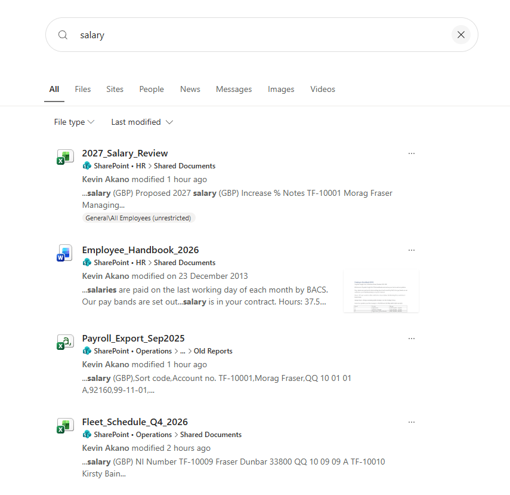
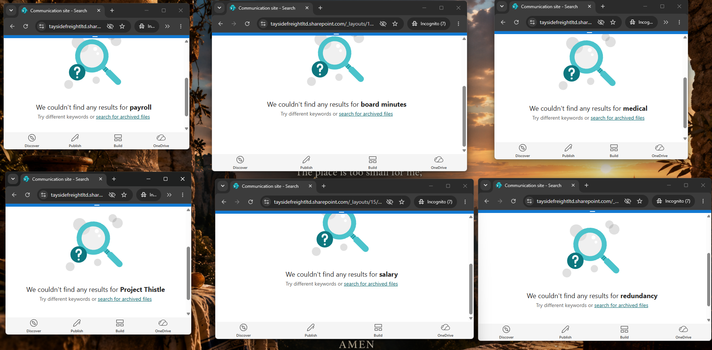
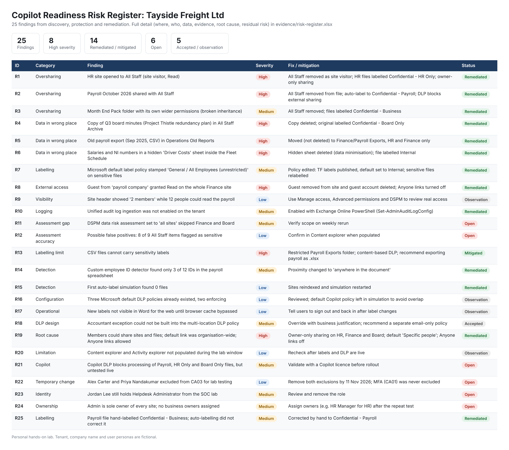
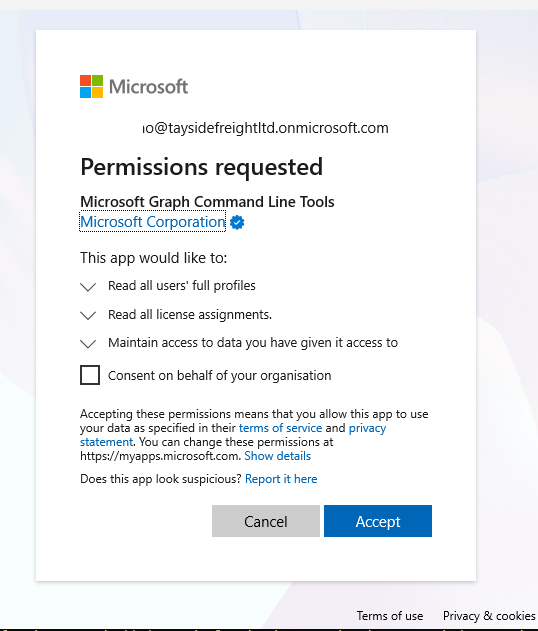
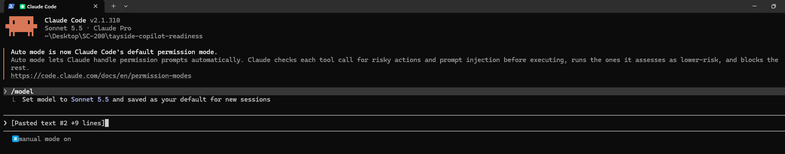
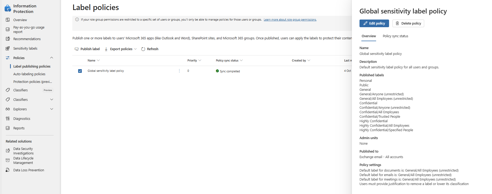

# Copilot Readiness with Microsoft Purview: Finding and Fixing Oversharing Before AI Does

**A junior warehouse employee could search the company's SharePoint and find payroll, medical notes and a secret redundancy plan.** Microsoft 365 Copilot would have found them too. This project builds that company, proves the exposure, fixes it with Microsoft Purview and SharePoint controls, and proves the fix.

**Skills demonstrated:** Data Security · Information Protection (Sensitivity Labels) · Data Loss Prevention · Custom Sensitive Info Types (Regex) · Auto-Labelling · DSPM for AI · Audit & Investigation · SharePoint Permissions · Conditional Access · Risk Management · UK GDPR · Least Privilege

**Stack:** Microsoft Purview · SharePoint Online · Microsoft Entra ID · Microsoft Graph PowerShell · Exchange Online PowerShell · Python · Claude Code

---

## The problem

In **April 2023**, Samsung engineers pasted confidential source code into ChatGPT. Samsung responded by banning generative AI tools on company devices. [1]

In **June 2025**, researchers disclosed **EchoLeak (CVE-2025-32711)**, a zero-click flaw in Microsoft 365 Copilot. A single crafted email could make Copilot leak data from the user's own files and chats, with no click needed. Microsoft fixed it on the server side. [2]

The lesson: **Copilot can reach everything the user can reach.** It does not create new permissions. It exposes the bad ones that already exist. Before switching Copilot on, a company has to answer a simple question: *what can our most junior person find today?* Microsoft's own oversharing blueprint says the same thing. [3]

| Real-world failure | What this project builds |
|---|---|
| Sensitive files shared with "everyone" years ago | Discovery by searching **as a junior user**, then proof from the audit log |
| Microsoft's default label marks everything "All Employees (unrestricted)" | Six custom labels with encryption, a safer default and justification to downgrade |
| Built-in detectors don't know company-specific data | Three custom regex detectors (employee ID, NI number, sort code) tested to 12/12 |
| Copilot summarises whatever it can open | A DLP policy that stops Copilot using Payroll, HR Only and Board Only files |
| Fixes get undone by the next "quick share" | Owner-only sharing, Anyone links off, default link set to Specific people |
| "We fixed it" with no evidence | Before/after tests, a positive control, a 25-row risk register and an audit evidence workbook |

---

## How it works: the five-step loop

```
Build the mess → Discover (search as the user + audit + DSPM) → Protect (labels, detectors, auto-labelling, DLP) → Remediate (permissions, data clean-up, sharing settings) → Prove (re-test + positive control + audit evidence)
```

| Layer | Tech |
|---|---|
| Company build | Python (42 fake files) + PowerShell / Microsoft Graph (12 users, 5 groups, 5 SharePoint sites) |
| Discovery | SharePoint search as the junior user · Purview Audit · DSPM for AI data risk assessment |
| Protection | Sensitivity labels · custom sensitive info types · auto-labelling · DLP (including the Copilot location) |
| Identity | Entra ID Conditional Access (MFA, block legacy auth, compliant device) |

---

## Before and after

**Before:** Alex, a warehouse employee, searches for "salary" and finds the 2027 salary review, an old payroll export and a fleet schedule hiding salaries in a hidden sheet.



**After:** the same six searches return nothing.



| Measure | Before | After |
|---|---|---|
| Sensitive files Alex could find (6 searches) | **6** | **0** |
| Direct link to payroll | Opens | "You can't access this item" |
| Alex's own work files (positive control) | Found | Still found |
| HR member resharing HR-only files | Possible | Blocked |
| Files with a meaningful label | 0 | All sensitive files |

---

## The three parts

1. **[Discover: How a Junior Employee Found Payroll, Medical Notes and a Secret Redundancy Plan](01-discover.md)**: the company, the mess, and what discovery found (including where Microsoft's own tools missed things)
2. **[Protect: Labels, Custom Detectors, Auto-Labelling and DLP](02-protect.md)**: six labels, three regex detectors, auto-labelling and two DLP policies
3. **[Remediate & Prove: From 6 Exposed Files to 0, and Making It Impossible to Repeat](03-remediate-and-prove.md)**: the fixes, the re-tests, stakeholder pushback and an external accountant

**Evidence:** [`evidence/risk-register.xlsx`](evidence/risk-register.xlsx) (25 findings with severity, root cause, fix and residual risk) · [`evidence/audit-evidence.xlsx`](evidence/audit-evidence.xlsx) (every fix traced in the audit log)



---

## Key design decisions (what tutorials skip)

- **Test as the user, not as the admin.** An admin sees everything, so admin testing proves nothing. Every "before" and "after" test was run signed in as Alex.
- **Always run a positive control.** "Zero results" could just mean search is broken. Alex still finding his own rota and fleet files proves the block is targeted.
- **Don't trust "all sites".** The DSPM data risk assessment set to all sites skipped Finance and Board, the two most sensitive. Coverage has to be checked, not assumed.
- **The default label matters more than any label you create.** Microsoft's default policy stamped payroll as *General / All Employees (unrestricted)*. That label looks like protection but gives none.
- **Simulation before enforcement.** Auto-labelling and both DLP policies ran in simulation first. The first auto-label simulation found 0 files; the cause was an out-of-date search index, not the rule.
- **Deleting beats labelling.** An old payroll export and a copy of the board minutes were deleted, not protected. Data you don't keep can't leak.
- **Least privilege for the build itself.** The Graph scripts ask only for the scopes they need, and "Consent on behalf of your organisation" was left unticked.



- **AI-written code, human-approved.** The build scripts were written with Claude Code in manual mode, so every file change and command needed my approval. The scripts have dry-run modes, and the answer key and test credentials are kept out of Git.



- **Mistakes caught are part of the work.** The label policy was first published to only 1 account. Spotted in review and changed to All.



---

## Trade-offs and open items

- **Owner-only sharing adds friction.** HR and Finance members can no longer invite anyone. Owners handle sharing requests.
- **The accountant exception.** The Finance Director needed to send payroll to an external accountant. A domain-based exception isn't possible in a DLP policy that covers SharePoint as well as email, so the share was done by the owner, view-only, for one file.
- **Manual labels win.** Auto-labelling never overrides a label a person applied by hand, so a wrong manual label has to be found and fixed by a person.
- **Under investigation:** DLP did not block the external share of the payslip CSV, which contains employee IDs. Also unconfirmed: whether DLP alerts reach Defender XDR and Sentinel.

## Future improvements

Make the Finance Director the Finance site owner · route DLP alerts into Sentinel · item-level DSPM scanning · retention policies for old exports · scheduled SharePoint access reviews · an E3 vs E5 cost comparison · the next project: securing AI agents with Microsoft Entra.

---

## References

1. The Register: [Samsung bans generative AI after staff leak source code](https://www.theregister.com/2023/05/02/samsung_generative_ai_ban/) (May 2023).
2. The Hacker News: [Zero-click AI vulnerability exposes Microsoft 365 Copilot data (EchoLeak, CVE-2025-32711)](https://thehackernews.com/2025/06/zero-click-ai-vulnerability-exposes.html) (June 2025).
3. Microsoft Learn: [Microsoft 365 Copilot deployment blueprint: address oversharing](https://learn.microsoft.com/en-us/copilot/microsoft-365/microsoft-365-copilot-blueprint-oversharing).

*Personal hands-on lab by Kevin Akano. Tenant, company name, and user personas are fictional. All personal data is fake (QQ-prefix NI numbers, 99- sort codes, test card numbers).*
